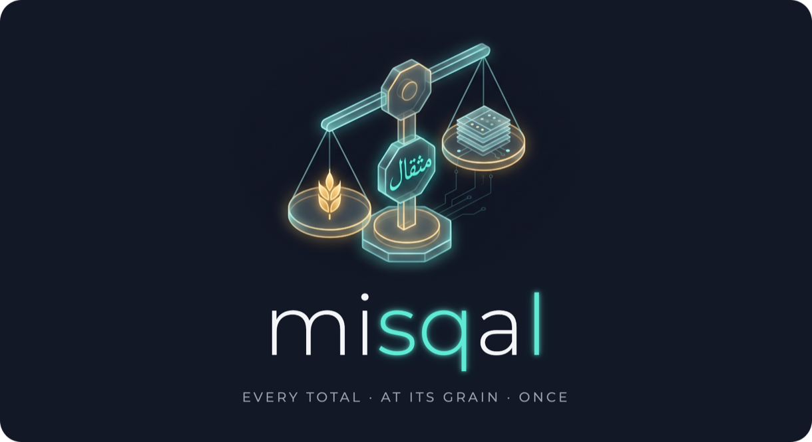
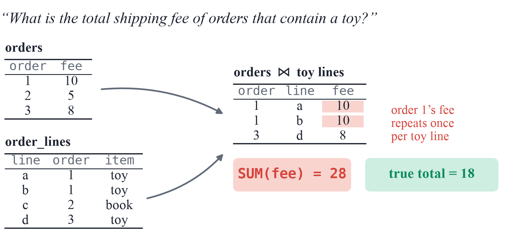
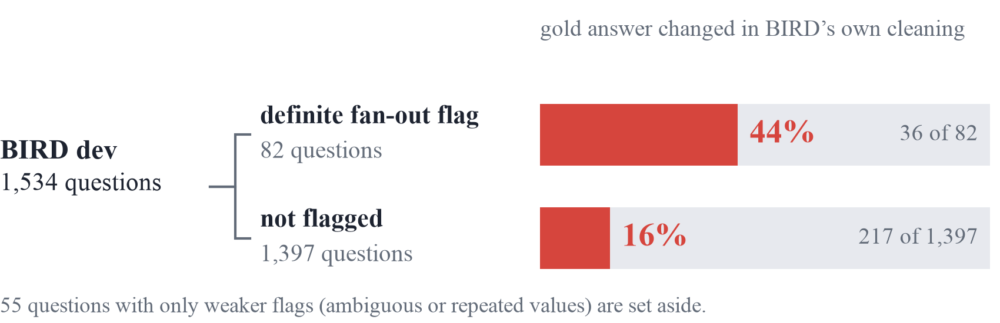

<p align="center">
  
</p>

**misqal** (mi**SQ**a**L**, from Arabic *mithqāl* مثقال, the weight used for gold and grain; *misqāl* in
Egyptian Arabic) checks that SQL measures every total at its grain, once.

Code and benchmarks for the paper [*Mind the Trap As LLMs Guess the Data Model: Grain-Aware Guards
Against Fan-out in Text-to-SQL and Its Benchmarks*](https://arxiv.org/abs/2611.29009) (arXiv:2611.29009).
Archived release: [doi:10.5281/zenodo.24627215](https://doi.org/10.5281/zenodo.24627215); datasets on
Hugging Face: [bird-fanout](https://huggingface.co/datasets/ahmed-mahran/bird-fanout),
[graintraps](https://huggingface.co/datasets/ahmed-mahran/graintraps).

## The problem

<p align="center">
  <picture>
    <source media="(prefers-color-scheme: dark)" srcset="docs/fanout-example-dark.png">
    
  </picture>
</p>

The question needs the order lines to pick the orders, but the fee is stored once per order. The join
repeats order 1's fee once per toy line, so the sum counts it twice. The query runs and returns a
plausible number. These *fan-out errors* depend on two facts a schema does not show: each measure's
grain, and how many rows a join on each key repeats. misqal measures both on the data, with plain
aggregate SQL, and uses them twice:

- **The audit** (`misqal.fanout.audit`) checks a SQL query on its database: does a duplicate-sensitive
  aggregate (SUM, AVG, COUNT, ...) read rows that actually repeat under the query's own joins and
  filters?
- **The evidence** (`misqal.harness`) gives an LLM agent the dependencies of the tables it is shown,
  in the prompt or through a tool. The grain-aware version also states each measure's grain and how
  many rows each key value repeats.

## What we found

**Benchmark gold has it too.** Run on BIRD's gold queries, the audit finds distorted gold answers for
4.2% of the dev questions. BIRD's own later revision, made without our flags, changed 44% of the
answers the audit flags as definite fan-out, against 16% of unflagged ones.

<p align="center">
  <picture>
    <source media="(prefers-color-scheme: dark)" srcset="docs/bird-revision-dark.png">
    
  </picture>
</p>

**Models make it, and grain-aware evidence cuts it.** Without evidence, each of eight LLM agents makes
grain errors on GrainTraps, in 2% to 42% of runs. Grain-aware FDs cut fan-out errors on BIRD train
from 18.4% of runs to 13.1–13.6%, against 17.0% with per-column statistics, also on held-out
questions. Accuracy rises less, because most remaining errors are not fan-out.

| Arm (see [Evidence arms](#evidence-arms)) | GrainTraps grain errors | BIRD train fan-out errors | held-out | BIRD accuracy |
|---|---:|---:|---:|---:|
| no evidence | 17.4 | 18.4 | 16.1 | 60.3 |
| Stats | 12.8 | 17.0 | 15.1 | 61.2 |
| Stats+Rep (exploratory) | 10.8 | 15.1 | 13.9 | 62.3 |
| FD | 12.1 | 15.3 | 13.9 | 62.0 |
| FD (tool) | 13.1 | 14.7 | 12.9 | 62.0 |
| Grain-FD | 8.3 | 13.6 | 12.4 | **63.3** |
| Grain-FD (tool) | **7.7** | **13.1** | **12.2** | 63.2 |

% of runs, eight models. BIRD: the 229 distorted train questions (183 held out from the design of the
grain-aware evidence); fan-out errors are exact matches of the distorted gold plus answers an LLM
judge calls over-counts. Two metrics without any LLM judge lead to the same conclusions (see the
paper).

## Benchmarks

| Path | What |
|---|---|
| `benchmarks/graintraps/` | **GrainTraps**: 59 questions over three synthetic databases (29 base questions over six traps, 27 vague twins, 3 controls), generated by a Claude Code agent. |
| `benchmarks/bird-fanout-20251106/` | **BIRD-FanOut, dev**: 102 questions of BIRD's cleaned dev release (2025-11-06) whose gold is exposed to fan-out, with intent labels and corrected, reviewed gold. |
| `benchmarks/bird-fanout-train/` | **BIRD-FanOut, train**: 384 questions of BIRD train, built the same way. |
| `benchmarks/column-roles.jsonl` | The role of every column the benchmarks use: identifier, dimension or measure. |
| `benchmarks/bird-fanout/` | Pilot set from the June 2024 BIRD dev, used to choose the labelling judges. |

Both benchmarks are also on Hugging Face: [ahmed-mahran/bird-fanout](https://huggingface.co/datasets/ahmed-mahran/bird-fanout)
and [ahmed-mahran/graintraps](https://huggingface.co/datasets/ahmed-mahran/graintraps) (with its SQLite databases).

BIRD-FanOut has 486 questions: 295 *distorted* (the gold counted repeated rows; categories
`inflated` and `fixed_in_release`) and 191 *intended* (counting the repeated rows is right). Each
benchmark README explains how it was built. Every label and correction comes from LLM judges, with
checks by Claude agents; no person labelled the data.

## Evidence arms

| Paper | `--arm` | What the model gets |
|---|---|---|
| no evidence | `none-minimal` | the schema only |
| Stats | `stats-minimal` | rows, distinct values and NULLs per non-measure column |
| Stats+Rep | `stats2-minimal` | Stats plus how many rows each identifier value appears on |
| FD | `full-minimal` | the FD profile: inferred key, 1:N chains, the label of every column pair |
| FD (tool) | `facts-minimal-tool` | the same facts as sentences, from the `cardinality_matrix` tool |
| Grain-FD | `full2-minimal` | FD plus repetition counts, NULL-aware FDs and each measure's grain |
| Grain-FD (tool) | `facts2-minimal-tool` | the same additions as sentences from the tool, keys always included |

The evidence arms with a `-tool` suffix must call `cardinality_matrix` on every table the final query
reads. The code also has evidence `labels` and a `grain` procedure (e.g. `full-grain`), explored early
and not used in the paper, and a Spider 2.0-Lite loader (`--bench spider2`), also not used.

## Setup

```bash
uv sync                    # Python 3.12; add --extra spark for the Spark tests
uv run pytest              # offline, no API key or download needed
```

Run every command from the repository root. Downloaded data goes under `data/` (git-ignored):

- BIRD dev, cleaned release: `data/bird-dev-20251106/{dev.json, dev_databases/}` from the Hugging
  Face dataset `birdsql/bird_sql_dev_20251106`.
- BIRD train: `data/bird-train/train/{train.json, train_databases/}` from https://bird-bench.github.io.
- GrainTraps needs no download: `misqal.traps.generate` builds its databases deterministically.

API keys go in `.env` (git-ignored) or the environment. Model specs are `<prefix>:<model>`:
`cerebras:`, `groq:`, `together:` and `baseten:` use their public endpoints with `<PREFIX>_API_KEY`;
any other prefix is an OpenAI-compatible endpoint configured with `<PREFIX>_BASE_URL` and
`<PREFIX>_API_KEY` (e.g. `google:` with Gemini's OpenAI-compatible URL); anything else goes to
LangChain's `init_chat_model`.

## Reproducing the paper

The main runs: every arm, one run per BIRD question and three per GrainTraps question, the tables
of the question's reference queries only, provider-default temperature, up to 50 agent steps.

```bash
ARMS="none-minimal stats-minimal stats2-minimal full-minimal facts-minimal-tool full2-minimal facts2-minimal-tool"
COMMON="--known-tables --column-roles benchmarks/column-roles.jsonl --temperature none --workers 8"

uv run python -m misqal.harness.run --bench traps --repeats 3 --model <model> --arm $ARMS $COMMON --out runs/traps
uv run python -m misqal.harness.run --bench bird-fanout-20251106 --model <model> --arm $ARMS $COMMON --out runs/dev
uv run python -m misqal.harness.run --bench bird-fanout-train --model <model> --arm $ARMS $COMMON --out runs/train
```

Results append to `<out>/results.jsonl` (a rerun skips finished jobs) and full traces go to
`<out>/traces/<model>/<arm>/<task>.json`. Then:

| Step | Command |
|---|---|
| Score BIRD runs against the reviewed golds | `python -m misqal.harness.rescore runs/train --bench bird-fanout-train --to runs/reviewed` |
| Paired comparisons (bootstrap intervals, sign and permutation tests) | `python -m misqal.harness.stats traps runs/traps` |
| LLM-judged fan-out on BIRD | `python -m misqal.harness.judge_bird runs/reviewed/train --model <judge> --select other --out runs/judged.jsonl` |
| Did the model check the data? | `python -m misqal.harness.checking runs/traps` |
| The audit on submitted answers | `python -m misqal.fanout.audit_answers --bench bird-fanout-20251106 --runs runs/dev --out runs/audit-answers.jsonl` |

Building the benchmarks (each module's docstring gives its command): `misqal.fanout.bird_audit` (audit
of every gold query), `misqal.fanout.label` (judges' intent labels and corrections),
`misqal.fanout.bird_changes` (comparison with BIRD's later release), `misqal.fanout.build_subset`
(assembly), `misqal.fanout.gold_review` (review of every gold for other errors) and
`misqal.harness.column_roles` (column roles).

## Layout


| Path | What |
|---|---|
| `src/misqal/cardinality/` | The dependency profile of a table from aggregate SQL: pair labels (1:1, N:1, 1:N, M:N), keys, constants, hierarchies, with rule-based pruning; SQLite and Spark |
| `src/misqal/fanout/` | The audit, and the BIRD-FanOut pipeline (labels, release comparison, assembly, gold review) |
| `src/misqal/harness/` | The agent (`agent.py`), prompts and arms (`prompts.py`), grain-aware evidence (`evidence_v2.py`), benchmark loaders and scoring (`bench.py`), models (`models.py`), the run CLI (`run.py`) and the analysis tools |
| `src/misqal/traps/` | The GrainTraps databases |
| `tests/` | Unit tests, the profile checked against a brute-force FD oracle, and offline agent tests with a scripted model |

**NULL semantics.** The FD profile counts NULL as one value, as GROUP BY does. Then `d(A) = d(AB)`
holds exactly when `A → B` on the data, the condition for `GROUP BY A` not to fan out when `B` is
attached. The grain-aware evidence also re-checks each failed dependency on the filled-in rows only.

**Scoring.** On BIRD, `set_ex` is BIRD's execution match and `multiset_ex` also requires duplicate
rows to match. A run whose answer equals BIRD's original (distorted) gold is an exact fan-out error.

## Citation

If you use misqal, BIRD-FanOut or GrainTraps, please cite:

```bibtex
@misc{mahran2026misqal,
  title         = {Mind the Trap As {LLMs} Guess the Data Model: Grain-Aware Guards Against
                   Fan-out in Text-to-{SQL} and Its Benchmarks},
  author        = {Mahran, Ahmed M.},
  year          = {2026},
  eprint        = {2611.29009},
  archivePrefix = {arXiv},
  primaryClass  = {cs.DB},
  url           = {https://arxiv.org/abs/2611.29009}
}
```

BIRD-FanOut is derived from BIRD; please cite it as well:

```bibtex
@inproceedings{li2023bird,
  title     = {Can {LLM} Already Serve as A Database Interface? {A} {BI}g Bench for Large-Scale
               Database Grounded Text-to-{SQL}s},
  author    = {Li, Jinyang and Hui, Binyuan and Qu, Ge and Yang, Jiaxi and Li, Binhua and Li, Bowen and
               Wang, Bailin and Qin, Bowen and Geng, Ruiying and Huo, Nan and Zhou, Xuanhe and
               Ma, Chenhao and Li, Guoliang and Chang, Kevin C. C. and Huang, Fei and Cheng, Reynold and
               Li, Yongbin},
  booktitle = {Advances in Neural Information Processing Systems 36 (NeurIPS 2023), Datasets and
               Benchmarks Track},
  pages     = {42330--42357},
  year      = {2023}
}
```

## License

Code: Apache-2.0 (see `LICENSE`). The benchmarks under `benchmarks/bird-fanout*` and
`benchmarks/column-roles.jsonl` are derived from BIRD and are released under CC BY-SA 4.0, as BIRD is. GrainTraps
(`benchmarks/graintraps/`) is released under CC BY 4.0.
