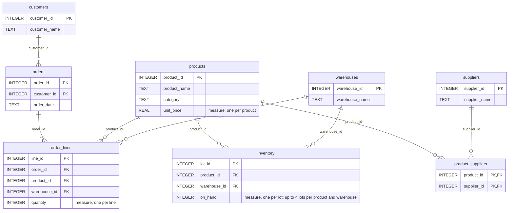
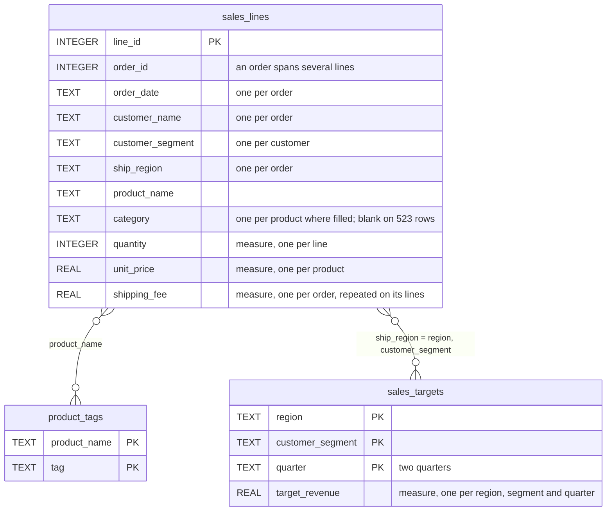
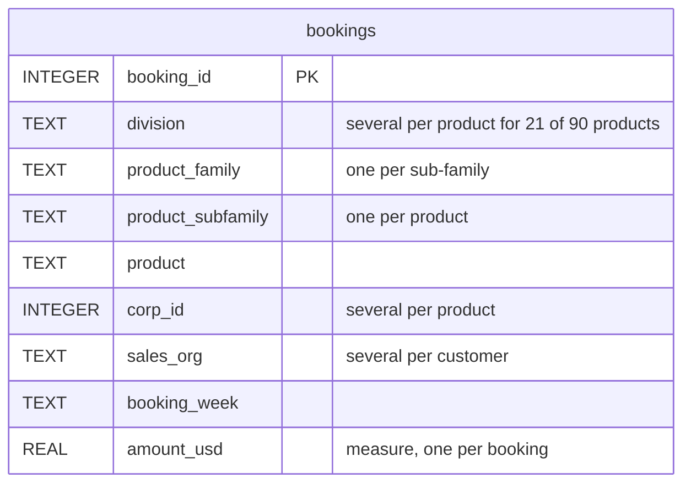

# GrainTraps

59 text-to-SQL questions over three small synthetic SQLite databases, built so that the obvious
query double-counts (or splits) a measure: 29 base questions over six traps, their 27 vaguely worded
twins, and 3 controls without a trap. The databases are generated deterministically by
`misqal.traps.generate`. The databases, questions, gold and naive SQL were generated by a Claude Code
agent and kept only if strong models could solve them; the paper calls this suite GrainTraps.

| Database | What it holds |
|---|---|
| `bookings` | One wide sales table. Each product has one sub-family and family, but some products are booked under two divisions, and every product is booked by several customers. |
| `supply` | Products, warehouses, customers, orders, order lines, inventory kept in several lots per product and warehouse, and a product-supplier mapping (many-to-many). |
| `shop` | One wide order-line table where order fields (customer, region, shipping fee) repeat on every line, some product categories are missing on part of the rows, plus many-to-many product tags and sales targets per region, segment and quarter. |

## Data models

What the schema shows, and what only the data shows: the comments give each column's grain, checked on
the generated databases. Models see only the `CREATE TABLE` statements.

**supply**: a normalized schema with a chasm trap (orders and inventory are both "many" per product)
and a many-to-many product-supplier mapping.

**shop**: one wide order-line table that hides an order entity, joined to product tags and sales
targets on non-key columns.

**bookings**: a single denormalized table; its hierarchy and many-to-many relationships exist only in
the data.

## Questions

32 questions are **explicit**: they name the grain of every measure. 27 of them have a **vague**
twin (id ending in `-v`), worded the way a user would ask, with the same gold answer. The vague
twin is still answerable: the data shows which reading is right.

Each entry in `questions.json` has:

| Field | Meaning |
|---|---|
| `id`, `db` | Question id and database. |
| `trap` | `fan`, `chasm`, `rank_then_attach`, `projection_join`, `mn_mapping`, `null_split`, or `control` (no trap). |
| `question` | The text the model sees. Nothing else from the entry is shown to the model. |
| `gold_sql` | A query giving the correct answer. |
| `alt_gold_sql` | Optional list: queries for other readings of the question that are also right. |
| `naive_sql` | The obvious query that falls into the trap (`null` for controls). Tests check it gives a different answer from the gold. |
| `trap_explanation` | What goes wrong in the obvious approach, and which facts in the data cause it. |
| `solution` | How to compute the right answer, in prose. |
| `vague_reading` | Vague twins only: what the wording leaves unstated and why the intended reading is the right one. |

## Scoring

An answer is correct when its rows match the gold rows as a multiset, ignoring row order and
column names, with floats rounded to 2 decimals. Column order follows the `Return columns` list.
A match with the gold or any `alt_gold_sql` counts as correct. Each answer also gets an outcome:
`correct`, `trapped` (same rows as `naive_sql`, or joins that actually repeat rows under a SUM,
AVG or COUNT), `other` (wrong for another reason) or `failed` (no SQL, or it did not run).

## License

CC BY 4.0.
